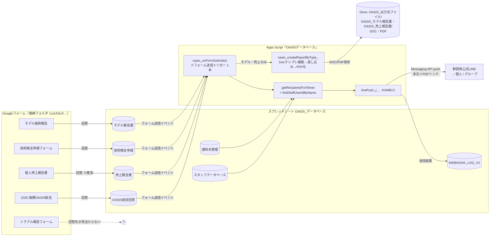
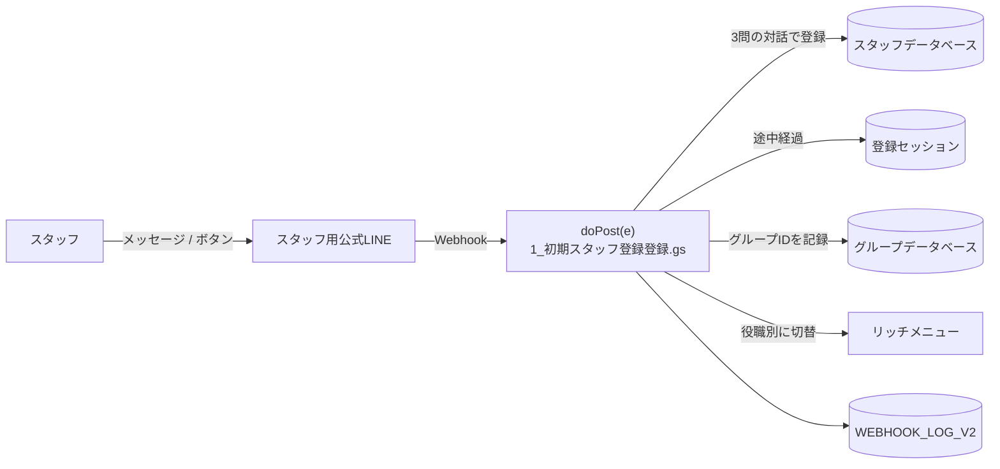

# OASIS 報告管理システム — 現行システム調査レポート

- 作成日: 2026-10-02
- 作成: AIプログラマー（Claude Code）
- 対象: OASIS PLUS の Googleフォーム → PDF生成 → LINE通知 の仕組み

> 表記ルール: **【事実】** はソースコード・シート・Driveの実データで確認したこと。**【推測】** は確認できていないこと。
> 個人情報保護のため、LINE の userId / groupId・スタッフの生年月日・モデル（お客様）の氏名はこの文書に書いていません。

---

## 0. 結論（先に要点）

1. **PDF生成とLINE送信の本体は、Apps Script「OASISデータベース」の 1 ファイル `3-1_モデル報告書のDOC、PDF作成.gs` の関数 `oasis_onFormSubmit()` に集約されています。**【事実】** フォーム送信1回につき「Googleドキュメントのテンプレをコピー → 差し込み → PDF化 → LINEへ push」を1本の関数で行っています。
2. **現在も本番で動いています。** 最新の送信は 2026-10-02 19:53（モデル報告書）で、PDF は `OASIS_出力先ファイル/OASIS_モデル報告書/PDF` に保存されていました。【事実】
3. **LINE WORKS へ送る処理は、調べた範囲では見つかりませんでした。** 送信ログ（WEBHOOK_LOG_V2）の送信先も、すべて LINE（幹部用公式LINE）の個人・グループだけでした。【事実】 → LINE WORKS への送信がどこで行われているかは **社長への確認が必要** です（§7）。
4. 「無題のプロジェクト 16RL5Vdo…」は **美容室の予約フォームの途中経過を記録する doPost だけ** のプロジェクトで、報告システムとは無関係でした。【事実】
5. 急ぎで対処したほうがよいセキュリティ上の問題が 3 点 ありました（§6）。中でも、**スプレッドシートの「リッチメニュー管理」シートの U1 セルに LINE のチャネルアクセストークンと思われる文字列が平文で入っています。**

---

## 1. 調査の方法と、調べられなかったこと

| 対象 | 方法 | 結果 |
|---|---|---|
| Apps Script「OASISデータベース」`1HRjPCre…` | Drive API でソース（全15ファイル）を取得 | 全ファイル確認済み |
| Apps Script「無題のプロジェクト」`16RL5Vdo…` | 同上 | 確認済み（対象外と判断） |
| Apps Script「無題のプロジェクト」`1D8fMIxP…` | ― | 依頼どおり対象外 |
| スプレッドシート OASIS_データベース `19O0o21_…` | xlsx 形式で取得し、全17シートを集計 | 確認済み |
| フォーム格納フォルダ `1zzUGIuX…` | Drive でファイル一覧を取得 | 確認済み（フォームは5件） |
| PDF / DOC の出力先フォルダ | Drive でフォルダ構成と最新ファイルを確認 | 確認済み |
| DOC テンプレート `1X4xs0ul…` | 本文を取得 | 確認済み |
| マイドライブ内のその他の Apps Script（9件） | タイトル・作成日を確認。うち新しい2件はソースも確認 | 報告システムとは無関係 |

**調べられなかったこと**（この環境の Drive API からは見えないため）:

- **トリガーの設定一覧**: Apps Script のトリガーは Drive API から見えません。コードの書き方から推測しています（§3）。
- **フォームやスプレッドシートに直接紐付いたスクリプト**（「コンテナバインド」と呼ばれるもの）: Drive の検索に出てこないため、存在するかどうかを確認できていません。**LINE WORKS への送信がここにある可能性があります。**【推測】
- **フォームの質問の中身と回答先**: Drive API ではフォームの中身を取得できません。回答先は、シートの列名とコードの対応から推測しています。
- **ウェブアプリのデプロイ設定**: `appsscript.json` に `webapp.access: ANYONE_ANONYMOUS` と書かれていることだけを確認しました。

---

## 2. 現行の構成図

### 2-1. 同じプロジェクトにある「別の仕組み」（今回は触らない）

同じ「OASISデータベース」プロジェクトの中に、**スタッフ用公式LINE の Webhook（ウェブアプリの `doPost`）** が同居しています。【事実】

> **大事な点**: このプロジェクトはウェブアプリとして公開済みで、LINE の Webhook の受け口になっています。ここに新しいダッシュボード（`doGet`）を足すと、Webhook の URL や動作に影響が出るおそれがあります。**新システムは別プロジェクトとして作るべきです**（`02_移行方針と設計案.md` を参照）。

---

## 3. トリガー構成（推測を含む）

| トリガー | 関数 | 種類 | 根拠 |
|---|---|---|---|
| フォーム送信 | `oasis_onFormSubmit` | スプレッドシートの「フォーム送信時」 | 【事実】`2_送信処理.gs` のメモに「いまフォーム送信で動くのは oasis_onFormSubmit() だけ（トリガーもこれ1本）」と書かれている。【推測】関数の中で `e.range.getSheet()` を使っているので、フォーム単位ではなく **スプレッドシート単位のトリガー**。 |
| ウェブアプリ | `doPost` / `doGet` | デプロイ（`ANYONE_ANONYMOUS`） | 【事実】`appsscript.json`。ログに 2026-02 以降のスタッフ登録イベントが記録されている。 |
| 時間主導 | なし（と思われる） | ― | 【推測】時間で動く処理がコード中に見当たらない。 |

→ **トリガーの実物は、Apps Script エディタの「トリガー」画面（時計のアイコン）で確認する必要があります。** PCから画面を見られるときに確認するか、スクリーンショットを共有してください。

---

## 4. データフロー詳細（`oasis_onFormSubmit`）

送信1件あたりの処理を順番に書きます（すべてソースで確認した【事実】）。

1. **どの帳票か判定**: 回答が書き込まれた **シート名** を `SHEET_TO_TYPE` で引く。
   - `モデル報告書` → modelReport（PDFあり・画像あり）
   - `売上報告書` → salesReport（PDFあり・テキストのみ）
   - `技術検定申請` → certApplication（**PDFなし・通知だけ**）
   - `OASIS総会回答` → meetingSurvey（**PDFなし・通知だけ**）
   - それ以外のシートは何もしない（→ **トラブル報告フォームは対象外**）
2. **行をオブジェクト化**: 1行目の列名（＝フォームの質問文）をキーにする。
3. **通知本文を作成**: 全列を「■列名\n値」の形で並べる（日付は `yyyy/MM/dd`）。
4. **PDF生成（モデル・売上のみ）**: `oasis_createReportByType_`
   1. 出力先 `OASIS_出力先ファイル`（`13xKInzY…`）の下に `OASIS_モデル報告書/DOC` と `/PDF` を探す（なければ作る）
   2. ファイル名を決める → モデル: `YYYY-MM-DD_担当者名_メニュー_モデル名様`
   3. **同名のPDFがすでにあれば作らずにそのURLを返す**（重複防止）
   4. DOC テンプレートをコピーし、`{{質問文}}` を回答で置き換える
   5. 画像は `{{ビフォー写真（３枚）}}` の位置に最大5枚まで、1行3枚で差し込む
   6. Doc を PDF に変換して PDF フォルダへ保存し、**「リンクを知っている全員が閲覧可」に設定**
5. **送信先を決定**:
   - `通知先管理` シートの C列（USERID）のうち、「全データ」列か、そのシート名の列が `有効` の行（個別列が `無効` なら除外）
   - さらに、`担当者名` が `スタッフデータベース` に登録されていれば、その人にも送る
6. **送信**: **幹部用公式LINE（KANBU）** のトークンで、宛先ごとに `push` API を1回ずつ呼ぶ。本文の最後にPDFのURLを付ける。
7. **ログ**: 送信ごとに `WEBHOOK_LOG_V2` に1行（`kind=PUSH`、HTTPコード、レスポンス本文）を書き込む。

### 4-1. 現在の宛先設定（通知先管理シート）

| 宛先 | 種類 | 全データ | 技術検定 | モデル | 総会 | 売上 |
|---|---|---|---|---|---|---|
| 個人A（幹部） | LINE個人 | 有効 | | | | |
| 個人B | LINE個人 | | | | | 有効 |
| 個人C | LINE個人 | | | | | |
| グループ「テスト」 | LINEグループ | 有効 | 無効 | 無効 | 有効 | 有効 |
| グループ「OASIS 業務」 | LINEグループ | 有効 | | | | |

→ 例えばモデル報告書1件では「個人A」と「OASIS 業務」グループの2か所（＋担当者がスタッフ登録済みならその本人）に届きます。依頼文にある「LINE公式グループ」は、**幹部用公式LINE が参加している「OASIS 業務」グループ** のことだと思われます。【推測】

### 4-2. フォームと回答シートの対応

| フォーム | 回答シート | 自動処理 | 備考 |
|---|---|---|---|
| モデル施術報告 `1pxVVKxP…` | モデル報告書 | PDF＋通知 | 16件（2025-11〜2026-10） |
| 技術検定申請フォーム `1zpZ841-…` | 技術検定申請 | 通知だけ | 1件 |
| 個人売上報告書 `1aEsmFG5…` | 売上報告書【推測】 | PDF＋通知 | 5件（2026-02〜03） |
| 2025,後期OASIS総会 `13J83Pk9…` | OASIS総会回答 | 通知だけ | 4件 |
| トラブル報告フォーム `1b7KrFbJ…` | **見当たらない** | **なし** | 回答先が未設定か、別のスプレッドシートの可能性 |
| （シート3） | 英語の列名のモデル報告書 | なし | 2025-11-13 の6件。初期テストの名残と思われる【推測】 |

`申請フォーム一覧` シートには、まだフォームのない **「給料UP申請」「有給申請」** が予定として載っています。

---

## 5. WEBHOOK_LOG_V2 の調査結果

- 期間: 2026-02-12 〜 2026-10-02、全117行
- 内訳: `PUSH` 51件（成功200: 48件 / **失敗400: 3件**）、`REPLY` 20件（全件成功）、`INFO` 46件
- **失敗3件はすべて同じ宛先**: グループ「己」宛て（2026-02-12 と 02-20）。現在の `通知先管理` にはこのグループが無いので、**今は解消済み** と判断しました。原因は LINE の `Failed to send messages` で、ボットがすでにグループから抜けていたことが考えられます。【推測】
- 列構成: `at, kind, userId, sourceType, eventType, step, name, role, replyCode, replyBody, message, raw`
  - 送信先が `message` 列に `channel=KANBU to=…` という **文字列で埋め込まれている** ため、「どのフォームの・どの提出の・どの宛先が失敗したか」を後から機械的に集計しにくい形です。
  - スタッフ登録の Webhook ログと送信ログが **同じシートに混在** しています。
- **新システムでの扱い**: このシートは現行の Webhook が書き込み続けているので、**列構成を変えずにそのまま残し**、新システムは送信ログ専用の別シート（`SEND_LOG`）を持つ方針にします。ダッシュボードでは新旧両方を表示できるようにします。

---

## 6. 見つかった問題・リスク

### 🔴 急ぎで対処を推奨（セキュリティ・個人情報）

| # | 内容 | 根拠 | 推奨対応 |
|---|---|---|---|
| S1 | **スプレッドシートに LINE のチャネルアクセストークンと思われる文字列が平文で入っている**（`リッチメニュー管理` シートの U1 セル。英数字と記号が172文字、末尾が `=` の形） | 【事実】シート内容 | スプレッドシートを共有されている人は誰でもそのLINE公式アカウントとしてメッセージを送れる状態です。**LINE Developers でトークンを再発行し、セルの値を削除** することをおすすめします。再発行すると、Script Properties の `CHANNEL_TOKEN_STAFF` / `CHANNEL_TOKEN_KANBU` のうち該当するほうも差し替えが必要です（どちらのトークンかは未確認）。**本番の通知が止まるので、作業の前に一言ください。** |
| S2 | **モデル写真の元ファイルを「リンクを知っている全員が閲覧可」に変えている** | 【事実】`oasis_fetchImageBlob_` の中で `file.setSharing(ANYONE_WITH_LINK, VIEW)` | お客様の顔写真が、URLさえ分かれば誰でも見られる状態です。差し込みには共有設定の変更は不要なので、新システムではこの処理を行いません。既存写真の共有設定を戻すかどうかはご判断ください。 |
| S3 | **生成したPDFも「リンクを知っている全員が閲覧可」** | 【事実】`oasis_createReportByType_` | LINE上でタップして開けるようにするための設定と思われます。新システムでは「組織内のみ」「ダッシュボード経由のダウンロードのみ」なども選べるようにします。 |

### 🟡 不具合・品質

| # | 内容 | 根拠 |
|---|---|---|
| Q1 | **写真の縦横比が崩れる**: 高さを260pxにしたあと、幅が150pxを超えると幅だけ150pxにしている（高さはそのまま）。横長・正方形の写真は細長く潰れます。 | 【事実】`oasis_insertImages_` |
| Q2 | **写真が粗い**: 1枚あたり約150×260pxに縮めて配置したうえで、Docs から PDF に変換しています。PDFへの変換時に画像が再圧縮される可能性があります。【推測】 | コード＋PDFサイズ（1件約1.2〜2MB） |
| Q3 | **HEIC（iPhoneの写真形式）は黙ってスキップ** され、PDFに載りません。 | 【事実】`oasis_fetchImageBlob_` |
| Q4 | **設定がシート名と質問文に依存している**: フォームの質問文を1文字でも変えると、列名が変わって差し込みが空欄になります。シート名を変えると、そのフォームは処理されなくなります。 | 【事実】`SHEET_TO_TYPE`・`{{質問文}}` 方式 |
| Q5 | **担当者本人への通知が届かない場合がある**: スタッフDBの名前とフォームの「担当者名」が完全に一致しないと送られません（例: フォームでは名字だけ入力）。 | 【事実】`findStaffUserIdByName` の完全一致 |
| Q6 | **宛先1件の失敗が記録されるだけで、再送の仕組みがない。** | 【事実】 |
| Q7 | スタッフ用LINEの Webhook で **署名の検証（X-Line-Signature）をしていない**（なりすましたリクエストも受け付ける）。今回の対象外ですが、念のため記録します。 | 【事実】`doPost` |
| Q8 | `4-6_キーワードで登録状態に戻す.gs` は、定義されていない変数 `LINE_CHANNEL_ACCESS_TOKEN` を参照しているため、呼ばれると必ずエラーになります（現在は誰からも呼ばれていません）。 | 【事実】 |

---

## 7. 社長に確認したいこと

1. **LINE WORKS への送信は、いまどこで行っていますか？**
   コードとログを調べた範囲では、LINE WORKS への送信は見つかりませんでした。考えられるのは次のどれかです。
   - (a) フォームやスプレッドシートに直接紐付いた別のスクリプトがある
   - (b) 人が手でLINE WORKSに転送している
   - (c) まだ無い（新システムで作りたい）
   - (d) 別のGoogleアカウントで動かしている
2. **トラブル報告フォームの回答は、どこに溜まっていますか？**（OASIS_データベース にはシートがありませんでした）
3. **個人売上報告書フォームの回答先は `売上報告書` シートで合っていますか？**
4. **トークンの再発行（S1）を、いつ実施してよいですか？**（本番の通知が数分止まります）

---

## 8. 参考: ファイル・ID 一覧

| 種類 | 名前 | ID |
|---|---|---|
| Apps Script | OASISデータベース | `1HRjPCreRZQJ63eQf3_OVI0PZJpIW1-Yznx54D0VRRIEhtJvvGbvOYWgW` |
| Apps Script | 無題（予約フォームの途中経過記録、対象外） | `16RL5VdoJ8EV1mLzG-DHyGwqxWA0De4W3iUajaL9HLAnWfqpDBy8zpZKq` |
| スプレッドシート | OASIS_データベース | `19O0o21_4FWMbMqHnX_2GIFQGytMpbztPNzbnfW_Qb8w` |
| Doc テンプレ | OASIS_モデル施術報告_テンプレート【編集禁止】 | `1X4xs0ulA0xiUoJb1EP4uWQTJH5JqH4avVD760sqeGQk` |
| Doc テンプレ | OASIS_売り上げ報告_テンプレート【編集禁止】 | `12huTyq3OvE4tU-tZthp5pZLj1LaMT6Myl-IZk1M-sZY` |
| フォルダ | OASIS_出力先ファイル（出力のルート） | `13xKInzYNzKkj4xOmunk0AwHavm_k_BPq` |
| フォルダ | 　└ OASIS_モデル報告書 | `1bC0a-VGwze0nV8dVMbQTw8m7M5vHU6Az` |
| フォルダ | 　　　├ DOC | `1L-QXqpDeMaRgvbl-RwR6AZ4r5gqgal0Z` |
| フォルダ | 　　　└ PDF | `1x_ksQjOIC2LxYtZwntb5ePOMbcILKjaL` |
| フォルダ | フォーム格納フォルダ | `1zzUGIuXWI2wxooI4ALhp2-SzcjxH1W5c` |

Script Properties で使っているキー名: `CHANNEL_TOKEN_STAFF`（スタッフ用公式LINE）、`CHANNEL_TOKEN_KANBU`（幹部用公式LINE）、`LAST_HIT`、`LAST_ERROR`（値は確認していません）。
