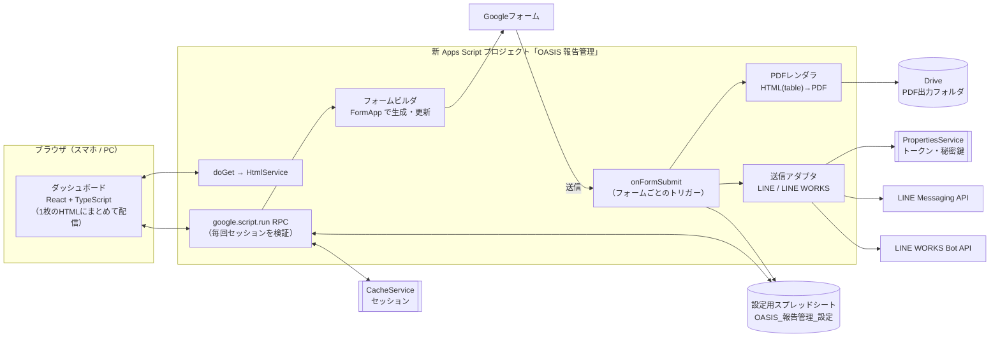

# OASIS 報告管理システム — 移行方針と設計案

- 作成日: 2026-10-02
- 前提資料: `01_現行システム調査レポート.md`
- 状態: **社長の確認待ち**（§10 の質問にお答えいただいてから実装に入ります）

---

## 1. 基本方針（5行で）

1. **新システムは、新しい Apps Script プロジェクトとして別に作ります。** 現行の「OASISデータベース」プロジェクトはスタッフ用LINEの Webhook も兼ねているため、触りません。
2. **設定はすべて、新しい設定用スプレッドシート「OASIS_報告管理_設定」に置きます。** コードに値を書き込まないようにします。トークンだけは PropertiesService に保存します。
3. **最初は「影運用」から始めます。** 現行の仕組みはそのまま動かし、新システムは「テスト」グループにだけ送ります。PDF も別のフォルダに出力します。結果を見比べて問題がなければ、フォーム1つずつ切り替えます。
4. **項目は「質問文」ではなく「フォームの項目ID」で管理します。** 質問文を変えても差し込みが壊れないようにするためです（現行の Q4 の解消）。
5. **PDF は HTML→PDF で作り直します。** レイアウトは table とインラインCSSで組みます。本実装の前に、`spike/pdf_spike.gs` で何が使えるかを確かめます。

---

## 2. 既存コードの流用 / 作り直し

| 現行の部品 | 判断 | 理由・変更点 |
|---|---|---|
| `linePush_` / `getToken_`（LINE push と トークン取得） | **流用** | 実績あり（成功率 48/51、失敗3件は宛先側の問題）。「送信アダプタ」の LINE 版として移植し、戻り値を構造化してログに残します。 |
| `oasis_extractDriveId_` / `oasis_fetchImageBlob_` | **一部流用** | ID の抜き出しはそのまま使います。**写真の共有設定を変える処理は削除します**（S2）。HEIC も取り込めるようにサムネイルAPI経由に変える案を検証します。 |
| `oasis_sanitizeFileName_` / `oasis_formatDate_` | **流用** | ファイル名の規則 `YYYY-MM-DD_担当者_メニュー_モデル名様.pdf` は変えません。 |
| 同名PDFがあれば作り直さない仕組み | **考え方を流用** | 「提出ID」で重複を判定する方式に変えます（同じ日に同じモデル・同じメニューの2件が衝突しないように）。 |
| `findStaffUserIdByName`（担当者本人への通知） | **流用（任意設定）** | フォームごとにON/OFFできるようにします。完全一致しか見ない点（Q5）は、スタッフマスタ側に「別名」列を設けて解消します。 |
| `oasis_onFormSubmit`（シート名で振り分ける入口） | **作り直し** | フォームごとのトリガーで `e.response`（項目ID付き）を受け取る方式にします。 |
| `oasis_createReportByType_` / `oasis_insertImages_`（Docs 差し込み） | **作り直し** | HTML→PDF に置き換えます。縦横比が崩れる不具合（Q1）と画質の問題（Q2）を解消します。 |
| `SHEET_TO_TYPE` / `REPORT_CONFIGS`（コード内の設定） | **作り直し** | 設定用スプレッドシートへ移し、ダッシュボードから編集できるようにします。 |
| `getRecipientsForSheet`（通知先管理シート） | **作り直し＋データ移行** | 「宛先マスタ」と「フォーム×宛先の振り分け表」に分けます。現在の5行は移行ツールで取り込みます。 |
| `debugLog2_` / WEBHOOK_LOG_V2 | **残す（読むだけ）** | 現行の Webhook が書き続けるので列は変えません。新システムは専用の `SEND_LOG` に書き、ダッシュボードでは両方を表示します。 |
| スタッフ登録 Webhook・リッチメニュー（`1_`, `4-*`） | **対象外** | 触りません。 |

---

## 3. 新システムの構成



### 3-1. 開発構成（新しいリポジトリ `oasis-report-system`）

```
oasis-report-system/
  src/server/        サーバー側（TypeScript → Apps Script 用の1ファイルにまとめる）
    main.ts          doGet / onFormSubmit / RPC の公開関数
    auth/            PBKDF2・セッション
    forms/           FormApp 生成・取り込み・差分の適用
    pdf/             HTML テンプレート描画・画像の取得・PDF 化
    send/            line.ts / lineworks.ts / router.ts
    repo/            設定スプレッドシートの読み書き
  src/client/        React ダッシュボード（Vite → 1枚の index.html）
  appsscript.json
  .clasp.json        （scriptId のみ。認証情報は入れない）
```

- クライアントは Vite と `vite-plugin-singlefile` で、JS と CSS を埋め込んだ1枚の HTML にします。HtmlService は外部の JS を読み込めないためです。
- サーバー側は Vite（または esbuild）で1ファイルにまとめ、公開関数をグローバルに出します。
- 型付きの RPC ラッパーを作り、`google.script.run` を Promise で呼べるようにします。
- テストは純粋なロジック（差し込み、ファイル名の生成、振り分け、PBKDF2）を Vitest で行います。GAS の API はモックします。

---

## 4. 設定用スプレッドシートの設計

| シート | 主な列 | 用途 |
|---|---|---|
| `FORMS` | formKey, 表示名, formId, 回答先シートID, 有効, モード(`shadow`/`live`/`off`), PDF作成, 担当者本人へ通知, ファイル名規則, PDF共有範囲 | フォームの一覧 |
| `FIELDS` | formKey, fieldKey, itemId, 型, 質問文, 説明, 必須, 選択肢(JSON), 並び順, セクション, PDF表示, PDF見出し, 画像設定(JSON) | 項目の定義（＝フォームの設計図） |
| `PDF_LAYOUTS` | formKey, version, タイトル, ブロック定義(JSON), 用紙, 余白, 更新者, 更新日時 | PDF のレイアウト（版を残す） |
| `DESTINATIONS` | destId, 表示名, 種類(`line_user`/`line_group`/`lineworks_channel`/`lineworks_user`), 宛先ID, チャネル(`KANBU`等), 有効 | 宛先マスタ（トークンは置かない） |
| `ROUTES` | formKey, destId, 有効, 本文テンプレート | 「このフォームはこの宛先へ」の対応表（1フォームに複数の宛先） |
| `USERS` | userId, ログインID, 表示名, ロール(`admin`/`viewer`), パスワードハッシュ, ソルト, 反復回数, 有効, 最終ログイン | ダッシュボードの利用者 |
| `STAFF` | 名前, 別名(カンマ区切り), LINE userId | 担当者本人への通知用（現行のスタッフデータベースと同期するか参照） |
| `SUBMISSIONS` | submissionId(=responseId), formKey, 提出日時, 担当者, 検索用テキスト, PDFファイルID, 状態, 処理時間ms | 提出の索引（一覧・検索・再ダウンロード用） |
| `SEND_LOG` | at, submissionId, formKey, destId, 種類, HTTPコード, 結果, エラー要約, 再送回数 | 送信結果（宛先1件につき1行） |
| `AUDIT_LOG` | at, ログインID, 操作, 対象, 変更前後の要約 | 誰が何の設定を変えたか |

- 回答の生データは、これまでどおりフォームの回答先シートに入ります。新システムは `SUBMISSIONS` に検索用の索引を持つだけです。
- 秘密情報は PropertiesService に `DEST_SECRET:<destId>:<名前>` の形で保存します。ダッシュボードでは「設定済み / 未設定」だけを表示し、値は二度と画面に出しません。

---

## 5. 機能ごとの設計メモ

### 5-1. フォーム項目の管理（FormApp）

| ダッシュボードの型 | FormApp | 備考 |
|---|---|---|
| 短文 | `addTextItem` | |
| 長文 | `addParagraphTextItem` | |
| 単一選択 | `addMultipleChoiceItem` | |
| 複数選択 | `addCheckboxItem` | |
| プルダウン | `addListItem` | |
| 日付 / 時刻 | `addDateItem` / `addTimeItem` | |
| 数値 | `addTextItem` ＋ 数値の入力チェック | |
| セクション見出し | `addSectionHeaderItem`（ページ区切りにするなら `addPageBreakItem`） | |
| **ファイルアップロード（画像）** | **⚠ FormApp・Forms API とも、新規作成ができません** | 下記の回避策をとります |
| 必須 | `setRequired` | |

**ファイルアップロードの制約と回避策**: Google の API では、アップロードの質問を新しく作ることができません。そこで次のようにします。
- 既存のフォームにあるアップロード項目は、取り込んで並び替えや PDF 表示の設定に使えます。
- 新しいフォームは、アップロード項目を1つ入れた「ひな形フォーム」を Drive 上でコピーして作ります。そのアップロード項目を使い回すか、不要なら削除します。
- 2つ目以降のアップロード項目が必要な場合は、ダッシュボードに「Googleフォームの画面で追加してください」と案内を表示します。追加したあと「取り込み」を押せば定義に反映されます。
- ※ 既存のアップロード項目の質問文や必須設定をAPIから変えられるかどうかは、実装の最初に確認します。

**既存フォームの取り込み**: `FormApp.openById(id).getItems()` で項目ID・型・質問文・選択肢・必須を読み、`FIELDS` に書き込みます。フォームそのものは変更しません。

**変更の反映（破壊的な変更を防ぐ仕組み）**:
1. ダッシュボードで編集すると、まず「差分プレビュー」を出します（追加 / 変更 / 並び替え / **削除**）。
2. **削除や型の変更が含まれる場合は、反映の前にフォームのバックアップコピーを自動で作り、確認画面を必ず挟みます。**
3. 項目IDが同じなら、回答先シートの列は維持されます。

並び替えは、ダッシュボードではドラッグ&ドロップ（`@dnd-kit` を想定）で行い、フォームには `form.moveItem` で反映します。

### 5-2. PDF（HTML→PDF）

- ブロックの種類: `title`, `section`（見出しの帯）, `fieldRow`（ラベルと値）, `fieldGrid`（2列）, `photos`（1行あたり N 枚）, `divider`, `text`（固定の文言）
- 編集できること: 並び順、表示/非表示、見出しの文言、セクション区切り、写真の列数・表示幅(mm)・取り込み解像度(px)・JPEG品質
- 写真: Drive から取得し、`data:` URI として HTML に埋め込みます。解像度を指定するために、サムネイルAPI（`sz=w1600` など）で縮小する案と、原寸を埋め込む案を **spike の T5 で比較** してから決めます。縦横比は保ちます（幅だけを指定）。
- プレビュー: ダッシュボードで「最新の提出」または「サンプルデータ」を選ぶと、サーバーで実際の PDF を作って表示します。HTML プレビューだと実物と見た目がずれるため、実物の PDF を出します。
- 実行時間: PDF 1件の生成時間を `SUBMISSIONS.処理時間ms` に記録します。写真が多くて時間がかかりそうなフォームには上限枚数を設けます。

### 5-3. 送信先

- **LINE（Messaging API）**: 現行と同じ push API を使います。チャネル（KANBU / STAFF / 追加分）ごとにトークンを PropertiesService に保存します。テキストは 5,000 字を超えないように切り詰めます。
- **LINE WORKS（Bot API 2.0）**: Service Account の JWT（RS256、`Utilities.computeRsaSha256Signature`）でアクセストークンを取得し、`/bots/{botId}/channels/{channelId}/messages` にテキストとPDFリンクを送ります。アクセストークンは CacheService にキャッシュします。必要な情報は Client ID / Client Secret / Service Account / Private Key / Bot ID / 送信先のチャネルID で、**LINE WORKS の Developer Console で発行してもらう必要があります**。
- ダッシュボードの「テスト送信」ボタンで、宛先ごとに疎通を確認できるようにします。
- 失敗した送信は `SEND_LOG` に記録し、ダッシュボードの「失敗一覧」から再送できるようにします。

### 5-4. 認証・権限

- パスワードは **PBKDF2-HMAC-SHA256**（ソルト16バイト、反復回数は設定値）でハッシュ化して保存します。GAS には PBKDF2 の関数がないため、純粋な JS の実装（例: `@noble/hashes`）をバンドルします。**反復回数は、GAS での実測値を見て決めます**（1回のログインが 2〜3 秒以内に収まる範囲で、できるだけ大きく）。
- セッション: ログインに成功するとランダムなトークンを発行し、CacheService に `{userId, role}` を保存します（最大6時間、操作のたびに延長）。トークンはブラウザ側で保持し、RPC のたびに送ります。ログアウトするとキャッシュを削除します。
- 権限: すべての RPC の入口で `requireRole('admin' | 'viewer')` を通します。閲覧ユーザー（一般）は参照系の RPC しか呼べません。
- ログイン試行の制限: 同じIDで5回失敗すると15分ロックします（CacheService）。
- 最初の管理者は、Apps Script エディタから `bootstrapAdmin()` を1回実行して作成します（パスワードは実行時に一時的に設定し、初回ログイン時に変更してもらいます）。
- ウェブアプリは「自分として実行・全員がアクセス可」でデプロイします。ログイン画面までは誰でも開けますが、データはすべてログイン後の RPC からしか返しません。

### 5-5. 提出済みレポートの一覧

- `SUBMISSIONS` を検索します（フォーム種別 / 担当者 / 日付範囲 / フリーワード）。件数が少ないうちはシート全体を読んで、サーバー側で絞り込みます。数千件を超えたら、月ごとのキャッシュを検討します。
- PDF の再ダウンロード: RPC で Drive のファイルを base64 にしてクライアントに渡し、ブラウザでダウンロードさせます。PDF の共有範囲を変えなくても取得できます。
- 「再生成」ボタンで、最新のレイアウトから PDF を作り直せます（管理者のみ）。
- 現行システムで作った過去のPDF（`OASIS_モデル報告書/PDF` など）は、移行ツールで `SUBMISSIONS` に索引として取り込みます。

### 5-6. 6分の実行時間制限への対策

- フォームの送信1件ごとに、PDF の生成と送信を1回の実行で行います（現行の実績から見て、1件は数十秒以内に終わる見込みです【推測】）。
- 一括処理（過去分の取り込み、一括再生成、再送）は、1回あたり約4分30秒で区切り、続きは時間主導トリガーで再開します（進み具合は PropertiesService に保存）。
- 1回の送信で処理が途中で終わった場合に備えて、`SUBMISSIONS.状態` が `pending` のまま残った提出を5分おきに拾い直します。

---

## 6. 並行稼働と切り替えの手順

| 段階 | 現行システム | 新システム | 確認すること |
|---|---|---|---|
| ① 構築 | 本番で稼働 | 未接続 | ― |
| ② 影運用 | 本番で稼働 | 全フォームを `shadow` に設定。「テスト」グループにだけ送り、PDF は別フォルダへ | PDF の見た目・画質、送信結果、実行時間 |
| ③ 1フォームずつ切り替え | 該当フォームの送信を止める ※ | 該当フォームを `live` にする | 二重に送信されていないか |
| ④ 全面切り替え | トリガーを停止（**削除はしない**） | すべて `live` | 1〜2週間の様子見 |
| ⑤ 片付け | トリガーを削除 | ― | **事前に確認をいただきます** |

※ ③で現行システムの送信を止める方法は、**現行コードには一切手を入れず**、`通知先管理` シートの該当列の値を `無効` に変えるだけで済みます（現行コードは個別列の `無効` を最優先するため）。ただし PDF の生成は続いてしまうので、PDF も止めたい場合は `SHEET_TO_TYPE` から1行消す必要があります。**どちらも本番の設定を変える操作なので、その都度確認をいただきます。**

---

## 7. 実装の順番（フェーズ）

1. **PDF の検証**（`spike/pdf_spike.gs`）← 最初に実施。結果に応じて §5-2 を確定します
2. 骨組み: リポジトリ、clasp、ビルド、ログイン、ロール、設定シートの初期化
3. フォームの取り込み（読み取りだけ）と、項目定義の画面
4. PDF レイアウトの編集とプレビュー
5. 宛先・振り分けの管理、テスト送信、送信ログ（LINE）
6. 影運用の開始（モデル報告書から）
7. LINE WORKS のアダプタ（§10-1 の回答次第）
8. フォームの生成・更新（差分プレビューつき）、新しいフォーム（有給申請など）の作成
9. 提出一覧・検索・再ダウンロード、過去分の取り込み
10. 切り替え

---

## 8. 社長にしていただく必要がある操作（PC が必要なもの）

スマートフォンだけでは難しい、**ブラウザでの OAuth 操作** が必要な場面は次のとおりです。該当する場面が来たら、その都度お知らせします。

| タイミング | 操作 | 理由 |
|---|---|---|
| フェーズ1 | `pdf_spike.gs` を新しい Apps Script プロジェクトに貼って実行し、権限を許可する | Drive への書き込み権限の許可が必要なため |
| フェーズ2 | `clasp login`（PC のターミナルでのGoogle認証）と、Apps Script API の有効化 | コードを Apps Script に送るため。※ 代わりに、ビルド済みのファイルを Apps Script エディタに貼り付ける方法もあります（PC のブラウザは必要） |
| フェーズ2 | ウェブアプリとしてのデプロイと、初回の権限許可 | Google の仕様で、本人の操作が必要なため |
| フェーズ5〜6 | フォームのトリガー作成の許可（`setupTriggers()` の初回実行） | 同上 |
| フェーズ7 | LINE WORKS Developer Console で Bot・Service Account を発行する | 管理者権限が必要なため |
| 随時 | GitHub で新しいリポジトリ `oasis-report-system` を作成し、Claude の GitHub アプリに追加する | こちらからはリポジトリを作成できなかったため（403エラー）。スマホのブラウザでも可能です |

---

## 9. この設計で解消されること

| 現行の問題 | 解消方法 |
|---|---|
| 項目の追加・PDF レイアウトの変更・フォームの追加のたびにコードを直している | すべてダッシュボードと設定シートで行えるようにする |
| 質問文を変えると差し込みが壊れる（Q4） | 項目IDで管理する |
| 写真の縦横比の崩れ・画質の劣化（Q1, Q2） | HTML→PDF に変え、幅だけを mm で指定し、解像度を指定できるようにする |
| HEIC の写真が載らない（Q3） | サムネイルAPI経由で JPEG にする（spike で確認） |
| 写真の共有設定を勝手に「公開」にしている（S2） | その処理を行わない |
| 送信の失敗に気づけず、再送もできない（Q6） | `SEND_LOG` と失敗一覧から再送できるようにする |
| LINE WORKS へ送れない（推測） | 送信アダプタを追加する |

---

## 10. 決めていただきたいこと

1. **LINE WORKS への送信は、いまどこで行っていますか？**（調査レポート §7-1 の a〜d）。LINE WORKS の管理者権限はお持ちですか？
2. **トラブル報告フォームの回答先**はどこですか？
3. **PDF の共有範囲**: LINE でタップしてすぐ開けるようにするため、現行どおり「リンクを知っている全員」にしますか？ それとも、ダッシュボードにログインしたときだけ取得できる形にしますか？（後者は、LINE のメッセージから直接は開けません）
4. **新しいリポジトリ**: `zin624/oasis-report-system`（非公開）という名前で作成していただけますか？ 作成するまでの間は、このリポジトリの `work/2026-10-02/oasis-report-system/` で作業を進めます。
5. **トークンの再発行（調査レポート S1）** を実施してよいタイミングはいつですか？
